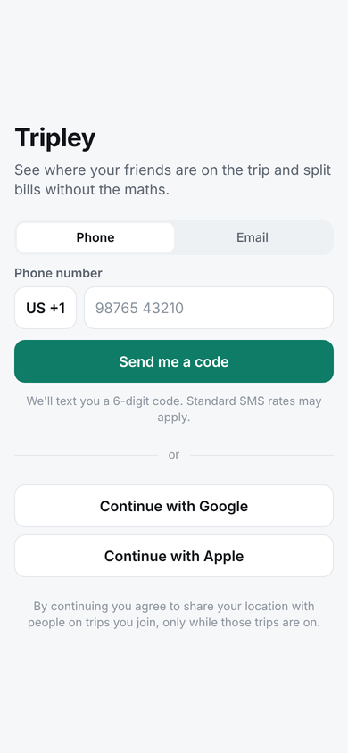
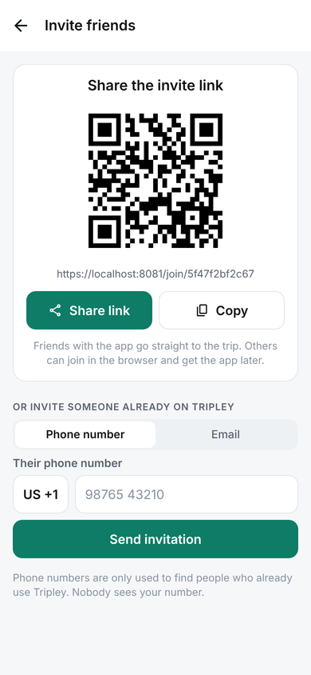
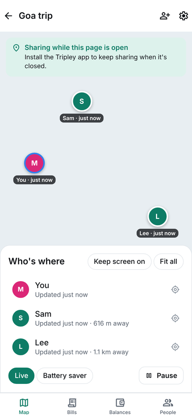
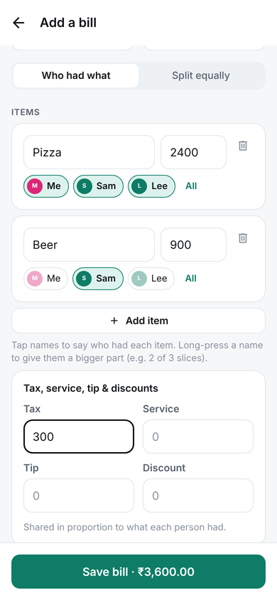
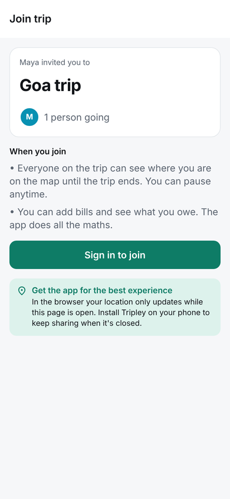
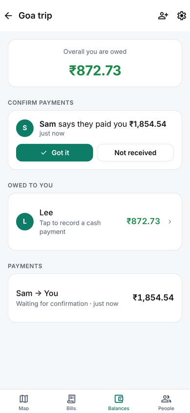
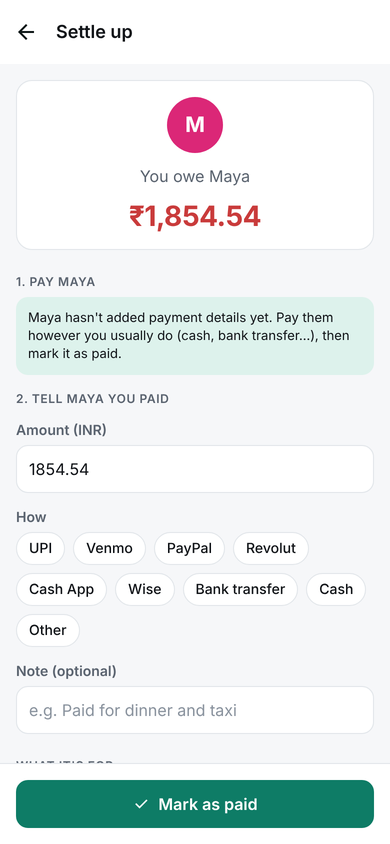
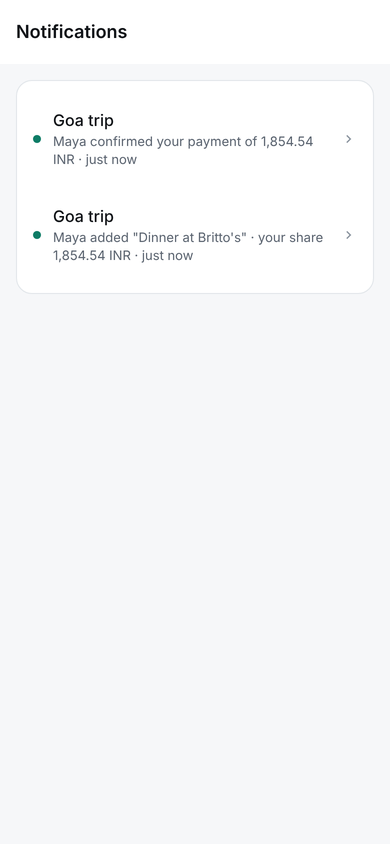

# Tripley

Group trips without the "where are you?" texts and the spreadsheet at the end.

**Live:** https://web-production-f080e3.up.railway.app (sign up with email and password, or try it as a guest)

- **Live map.** Everyone on the trip sees each other, even with the app closed (iPhone & Android). Pause anytime; sharing stops by itself when the trip ends.
- **Places, pins and arrival alerts.** Pin where you're staying, the airport, a meeting point, a great find or a photo memory. Places with alerts on tell the group "Cleo arrived at Hotel Artemide" (once per 30 minutes, never for where someone already was; each person can turn alerts off).
- **Find a lost friend.** A big arrow and "Ana is 50 m south of you" for crowds and markets. It turns with the phone's compass where there is one (iPhone, Android, Chrome on Android, Safari on iPhone after a tap).
- **Invite by link or in the app.** The organizer shares a link or QR code (WhatsApp, SMS…), or invites people already on Tripley by phone number or email. They tap Accept.
- **Bills split for you.** Whoever paid adds the bill, taps who had which item, and Tripley works out every share: shared items, tax, service, tip, discounts, other currencies. No maths. People who were within 150 m of the payer are picked automatically ("Split between the 2 of you here"), with one tap to include everyone.
- **Locked exchange rates.** A foreign-currency bill uses the European Central Bank rate for its date (or one you type), locked when saved and shown on the bill, so later swings never change anyone's share.
- **Settle up.** "You owe Maya ₹1,240" → **Pay** opens UPI / PhonePe / Paytm, Venmo / Zelle / Cash App, Revolut / Monzo / Wise / PayPal, or shows a SEPA QR code for euro bank transfers, ordered for the trip's region → **Mark as paid** → Maya taps **Got it**.
- **Trip home and dashboard.** A colourful dashboard with the trip that matters now (countdown, travellers, real planning progress), quick actions, reminders worked out from the group's plans, and recent activity. Each trip opens on an overview with a cover photo (or an illustrated postcard), what's next and a getting-ready checklist.
- **Activity feed.** Updates, photos (private to the trip), places you found and organizer announcements, with emoji reactions and comments; the feed also tells the trip's story by itself (joined, pinned, planned). Everyone picks which notifications they get.
- **Bucket list and polls.** Suggest places and things to do, vote, and turn the favourites into plans (once). Polls for "where should we eat?" with live results; a poll can take one choice or several, and whoever started it (or the organizer) can edit it while it's open.
- **Real places.** Destinations, ideas, plan stops and finds are searched by name or address ("Time Out Market", "Av. 24 de Julho 49") and picked from real places, so they're on the map with directions; the form shows whether a place was found. The map has its own search: fly to a place, then pin it or add it to the bucket list. Search uses OpenStreetMap data through Photon.
- **Dates and times without typing.** Every date and time field has a calendar or clock button (the browser's own picker on the web, the system picker on phones); typing still works.
- **Get ready.** A private packing list, shared group tasks with assignees, and optional light-hearted challenges.
- **Travel passport and memories.** Badges earned from real activity (private unless you share them), and a recap after the trip where you choose what to share.
- **Shared plan.** A day-by-day itinerary (Today / Day 1 / Day 2…): add the museum slot or the dinner booking with a time and place, say Going / Maybe / Not going, comment, see clashes, and get directions. The next day's stops show on the map.
- **Walking route for each day.** The plan measures the day's walk (from the pinned hotel, and back if you like) and suggests a shorter order: booked times stay in time order, sights are fitted where there's time to walk to them, and stops without a map point keep their place. It warns when a booking can't be reached on foot in time. Save the order in a tap (the organizer, or anyone moving only stops they added), walk it in Google Maps, or see it numbered on the trip map. Distances are straight lines between stops with an allowance for streets, so no paid routing service is needed (`src/lib/route.ts`).
- **Cash kitty.** Pool cash with one person for taxis and street food. Put cash in, spend from it, hand it over; Tripley shows what's left and who holds it, and it flows into everyone's balances so leftovers come back on settling up.
- **Works offline.** The web app installs to the home screen and opens without a connection (a service worker keeps the app and recent map tiles; trips, bills and balances are kept on the device). Bills added offline wait on the device and are sent once, exactly once, when you're back online.
- **Accounts.** Sign up with email and password, log in on any device, reset a forgotten password by email. Guests can try it with just a name and save their account later without losing their trips.
- **Free + Pro.** Everything is free except **AI receipt reading** (Tripley Pro): snap the receipt and the items, prices, tax and tip are filled in.

One codebase (Expo / React Native) runs on iPhone, Android and the web. Backend is Supabase (Postgres, Auth, Realtime, Storage, Edge Functions).

| Sign in | Invite | Live map | Who had what |
|---|---|---|---|
|  |  |  |  |
| **Join by link** | **Balances** | **Settle up** | **Notifications** |
|  |  |  |  |

<sub>Screenshots from the web build during the end-to-end test. The map background is blank because map tiles were blocked in the test environment.</sub>

---

## How it fits together

```
 iPhone / Android app ─┐                         ┌─ Postgres (tables + Row Level Security)
 (background location) │   Supabase              ├─ Auth (phone SMS via Twilio Verify, email code, Google, Apple)
                       ├──────────────────────── ├─ Realtime (map dots, bills, payments update live)
 Web app (browser) ────┘                         ├─ Storage (receipt photos, private per trip)
                                                 └─ Edge Functions
                                                     ├─ scan-receipt ──> Claude (AI receipt reading, Pro only)
                                                     ├─ send-push ────> Expo push (APNs / FCM)
                                                     └─ revenuecat-webhook <── RevenueCat (App Store, Google Play, Stripe)
```

- **Who can see what** is enforced in the database (`supabase/migrations`): only trip members see a trip's people, locations, bills and payments; you can only write your own location while you're sharing and the trip is on; bills are written through `save_bill()`, which checks that all the shares add up and the exchange rate matches.
- **Splitting** happens in `src/lib/split.ts` using whole cents and the largest-remainder method, so shares always add up exactly (100 split three ways is 34/33/33). Balances are netted per pair of people in `src/lib/balances.ts`.
- **Location** (`src/location`): on phones a background task (`expo-location` + `expo-task-manager`) uploads your latest position (only the latest is kept, no history). In browsers, location only updates while the page is open; the app says so and suggests installing.

### Limits worth knowing

- **Browser-only users** share only while the page is open. Browsers don't allow background location.
- **iPhone:** if someone force-quits the app (swipes it away), iOS can stop updates until it's opened again. Friends see "last seen 25 min ago" and the person gets a "tap to resume" reminder (`nudge_stale_sharers()`, every 15 min).
- **Android:** some brands' battery savers (Xiaomi, Samsung, OnePlus…) kill background apps. Ask people to turn off battery optimization for Tripley.

---

## Repository layout

```
src/app/                 Screens (Expo Router). trip/[id]/(tabs) = Map, Bills, Balances, People
src/components/          UI kit, map (native + web), pickers
src/lib/                 split engine, balances, currency, pay links, API, queries
src/location/            background task (native), foreground sharing (web)
src/providers/           auth + location-sharing state
src/purchases/           RevenueCat (Pro)
src/notifications/       push registration (native)
supabase/migrations/     schema, access rules, server functions, scheduled jobs
supabase/functions/      scan-receipt, send-push, revenuecat-webhook (Deno)
supabase/config.toml     auth providers, redirect URLs, function settings
tests/unit/              split / balances / currency / pay links (Vitest)
tests/db/                database + access rules, on a local Postgres
public/.well-known/      iOS universal links + Android app links (fill in your IDs)
```

---

## What you need (accounts and keys)

| Resource | What for | Cost (approx., check current pricing) |
|---|---|---|
| Supabase project | Database, login, realtime, storage, functions | Free tier to build; Pro ~$25/month at launch |
| Email sending (SMTP): Gmail app password, Brevo, Resend, Postmark… | Password-reset emails (and email codes / confirmations if turned on) | Free tiers cover early use |
| Twilio account + **Verify** service | SMS login codes | Pay per verification (~$0.05, varies by country) |
| Apple Developer Program | iPhone app, TestFlight, Sign in with Apple, push | $99/year |
| Google Play Console | Android app | $25 one-time |
| Expo account (EAS) | Cloud builds for iOS/Android, push service | Free tier |
| Anthropic API key | AI receipt reading (Pro) | ~$0.03 per receipt with `claude-opus-5-5` |
| RevenueCat (+ Stripe for web) | Pro subscriptions on App Store, Play, web | Free up to a revenue threshold; store fees 15–30% |
| Google Cloud OAuth client | "Continue with Google" | Free |
| A domain (e.g. tripley.app) | Invite links that open the app | ~$10–20/year |
| Vercel (or any static host) | The web app | Free to start |
| Map tiles | Map | OpenFreeMap is used by default (free, no key); MapTiler optional |

---

## Setup

### 1. Install

```bash
npm install
cp .env.example .env.local   # then fill it in (step 3)
```

### 2. Supabase

```bash
npx supabase login
npx supabase link --project-ref YOUR_PROJECT_REF
npx supabase db push                     # creates tables, access rules, functions, jobs
npx supabase functions deploy scan-receipt send-push revenuecat-webhook
npx supabase secrets set ANTHROPIC_API_KEY=... REVENUECAT_WEBHOOK_SECRET=... PUSH_WEBHOOK_SECRET=...
```

Optional function settings: `ANTHROPIC_MODEL` (default `claude-opus-5-5`), `ANTHROPIC_EFFORT` (default `low`), `AI_SCAN_MONTHLY_LIMIT` (default `60`), `EXPO_ACCESS_TOKEN` (if you turn on Expo push security), `REVENUECAT_ENTITLEMENT_ID` (default `pro`).

In the Supabase dashboard:

1. **Authentication → Providers**
   - **Phone:** enable, SMS provider **Twilio Verify** (Account SID, Auth Token, Verify Service SID).
   - **Email:** enable. In **Email Templates → Magic Link**, include `{{ .Token }}` so people get a 6-digit code.
   - **Google:** client ID + secret from Google Cloud.
   - **Apple:** Services ID (web) and your bundle ID `app.tripley` (native) as client IDs, plus the secret key.
   - Turn on **manual identity linking** if you want people to add email/Google to a phone account.
2. **Authentication → URL configuration:** Site URL `https://YOUR_DOMAIN`, redirect URLs `tripley://**` and `https://YOUR_DOMAIN/**`.
3. **Database → Webhooks → Create:** table `notifications`, event `INSERT`, type *Supabase Edge Functions*, function `send-push`, header `x-webhook-secret: <PUSH_WEBHOOK_SECRET>`. This turns every notification into a push.
4. **Database → Extensions:** make sure `pg_cron` is enabled (the migration schedules the stale-location reminder and the location clean-up when it is).

`supabase/config.toml` has the same auth settings for `supabase config push` / local development.

### 3. App configuration (`.env.local`)

| Variable | Value |
|---|---|
| `EXPO_PUBLIC_SUPABASE_URL` / `EXPO_PUBLIC_SUPABASE_ANON_KEY` | Project Settings → API (publishable key) |
| `EXPO_PUBLIC_APP_DOMAIN` | Your domain, e.g. `tripley.app` (invite links: `https://<domain>/join/<code>`) |
| `EXPO_PUBLIC_MAP_STYLE_URL` | Optional; defaults to OpenFreeMap |
| `EXPO_PUBLIC_REVENUECAT_IOS_KEY` / `_ANDROID_KEY` / `_WEB_KEY` | RevenueCat public SDK keys |
| `TRIPLEY_BUNDLE_ID` | Defaults to `app.tripley` |
| `EAS_PROJECT_ID` | From `npx eas-cli init` (needed for push notifications) |

### 4. Run it

```bash
npx expo start --web          # web app at http://localhost:8081
```

Phones need a **development build** (background location, maps and in-app purchases don't run in Expo Go):

```bash
npx eas-cli@latest init
npx eas-cli@latest build --profile development --platform ios
npx eas-cli@latest build --profile development --platform android
npx expo start --dev-client
```

### 5. Pro (RevenueCat)

1. Create products in App Store Connect and Google Play (e.g. monthly `tripley_pro_monthly`), and a Stripe product for web (RevenueCat Web Billing).
2. In RevenueCat: entitlement **`pro`**, an offering containing those packages, and the public SDK keys above.
3. **Integrations → Webhooks:** URL `https://YOUR_PROJECT.supabase.co/functions/v1/revenuecat-webhook`, Authorization header `Bearer <REVENUECAT_WEBHOOK_SECRET>`.

The app logs in to RevenueCat with the Supabase user id; the webhook keeps `accounts.plan` in sync and `scan-receipt` checks it.

### 6. Links that open the app

Fill in `public/.well-known/apple-app-site-association` (your Apple Team ID) and `public/.well-known/assetlinks.json` (your Android signing certificate SHA-256, from `npx eas-cli credentials`), deploy the web app to your domain, and set `EXPO_PUBLIC_APP_DOMAIN`. Invite links then open the app when it's installed, and the website otherwise.

### 7. Deploy the web app

`vercel.json` is included: import the repo in Vercel, add the `EXPO_PUBLIC_*` variables, deploy, and point your domain at it. Or host everything on Railway (next section).

---

## Hosting on Railway (current live setup)

Tripley runs in the Railway project **tripley**: the open-source Supabase stack plus the website, all in one project.

- Website: https://web-production-f080e3.up.railway.app
- API: https://supabase-production-4a6b.up.railway.app

| Service | What it is |
|---|---|
| `db` | Postgres (Supabase image) with a volume |
| `auth`, `rest`, `realtime`, `storage`, `meta`, `functions` | Supabase's sign-in, REST API, live updates, file storage (volume), dashboard backend, edge runtime |
| `studio` | The Supabase dashboard |
| `supabase` | Gateway: the public API URL (`https://supabase-production-….up.railway.app`), and Studio behind a login |
| `web` | This repo: built with `npm run export:web` (copies the map worker into `public/`, runs `expo export --platform web`, then lists every file for the service worker with `scripts/precache-manifest.cjs`), served by `scripts/serve-web.cjs` |

**How a deploy works.** Pushing to the deployed branch rebuilds `web`. Before the new version goes live, Railway runs the pre-deploy command `node scripts/migrate.cjs`. It applies any new file in `supabase/migrations/` once, recorded in `supabase_migrations.schema_migrations` (the Supabase CLI's table). If a migration fails, the deploy stops and the old version keeps running.

**`web` variables:**

| Variable | Value |
|---|---|
| `DATABASE_URL` | `postgresql://postgres:${{db.POSTGRES_PASSWORD}}@${{db.RAILWAY_PRIVATE_DOMAIN}}:5432/postgres` (server-side, migrations only) |
| `EXPO_PUBLIC_SUPABASE_URL` | `https://${{supabase.RAILWAY_PUBLIC_DOMAIN}}` |
| `EXPO_PUBLIC_SUPABASE_ANON_KEY` | Public anon key, printed in the `supabase` gateway's deploy logs |
| `EXPO_PUBLIC_AUTH_METHODS` | `password,guest` |
| `EXPO_PUBLIC_APP_DOMAIN` | `${{RAILWAY_PUBLIC_DOMAIN}}` |
| `EXPO_PUBLIC_EMAIL_SENDING` | Not set (off) until SMTP works on `auth` (below); then `on` |
| `EXPO_PUBLIC_GEOCODER_URL` | Not set: address search uses the free public Photon server. Set it to your own Photon server if you outgrow it |
| `EXPO_PUBLIC_SUPPORT_EMAIL` | Not set yet. The public contact address for the Privacy Policy and Terms; add it, then redeploy `web` |
| `NODE_ENV` | `production` |

**`auth` variables:**

| Variable | Value |
|---|---|
| `GOTRUE_EXTERNAL_ANONYMOUS_USERS_ENABLED` | `true` (guests) |
| `GOTRUE_EXTERNAL_EMAIL_ENABLED` | `true` (email + password accounts) |
| `GOTRUE_DISABLE_SIGNUP` | `false` |
| `GOTRUE_PASSWORD_MIN_LENGTH` | `8` |
| `GOTRUE_MAILER_AUTOCONFIRM` | `true` for now: accounts work without confirming the email. Set `false` once SMTP works to require confirmation |
| `GOTRUE_MAILER_URLPATHS_RECOVERY` | `https://${{web.RAILWAY_PUBLIC_DOMAIN}}/reset-password`: the reset email links straight to the website with a one-time token, so it works on any device |
| `GOTRUE_MAILER_SUBJECTS_RECOVERY` | `Reset your Tripley password` |
| `GOTRUE_SMTP_SENDER_NAME` | `Tripley` |
| `GOTRUE_SITE_URL` | The `web` URL |
| `GOTRUE_URI_ALLOW_LIST` | `https://<web>/**,tripley://**,http://localhost:8081/**` |

**Password-reset emails need SMTP.** Until `GOTRUE_SMTP_HOST` is set, the auth server accepts reset requests but sends nothing (its log says "Noop mail client being used"). So the app only offers a reset email when the `web` service has `EXPO_PUBLIC_EMAIL_SENDING=on`; without it, "Forgot password?" explains what people can do instead (change it from Profile on a device where they're still logged in, or contact you), and email-code sign-in stays hidden. To turn email on, add these to the `auth` service (put the password in yourself; it's a secret), then set `EXPO_PUBLIC_EMAIL_SENDING=on` on `web` and redeploy it, then try "Forgot password?" yourself:

| Variable | Gmail (app password) | Brevo |
|---|---|---|
| `GOTRUE_SMTP_HOST` | `smtp.gmail.com` | `smtp-relay.brevo.com` |
| `GOTRUE_SMTP_PORT` | `587` | `587` |
| `GOTRUE_SMTP_USER` | your Gmail address | your Brevo SMTP login |
| `GOTRUE_SMTP_PASS` | a 16-character app password (Google Account → Security → 2-Step Verification → App passwords) | your Brevo SMTP key |
| `GOTRUE_SMTP_ADMIN_EMAIL` | the same Gmail address (the "from" address) | a sender address verified in Brevo |

To add phone sign-in later, set the `GOTRUE_EXTERNAL_PHONE_ENABLED` and `GOTRUE_SMS_*` (Twilio Verify) variables there, then add `phone` to `EXPO_PUBLIC_AUTH_METHODS`.

**Studio (database dashboard).** Open the `supabase` gateway URL and log in as `supabase` with `DASHBOARD_PASSWORD`, which is in that service's variables in Railway.

**Cost.** Usage-based on Railway's Hobby plan. With all nine Supabase services the template's author estimates $20–40/month; light use is usually lower. Check *Usage* in the Railway dashboard.

**Backups.** Self-hosted means backups are on you. Railway volume backups can be enabled on the `db` volume.

**Checked live (8 Nov 2026).** A one-off script ran inside the Railway project against the public URLs, the way the app calls them, then deleted its test data:

- guest sign-up and name
- creating a trip, previewing the invite and joining by code
- sharing locations, with live map updates over realtime
- an itemized bill with tax, and a bill whose shares don't add up being rejected
- marking a payment as paid and confirming it, with notifications
- a stranger seeing no trip, map, bills or receipt photos
- CORS from the website
- `/` and `/join/<code>` serving the app

All 23 checks passed.

Accounts were checked the same way after they launched (21 of 21 passed): signing up and logging in with email and password, the 8-character minimum, duplicate emails and wrong passwords refused, a guest saving their account and logging in elsewhere as the same account, reset requests (with no hint whether an email has an account), and the reset link the email contains, which opens `/reset-password` on the website, works once and sets a new password.

---

## Testing

**CI.** `.github/workflows/ci.yml` runs on every push to the deployed branch and every pull request: typecheck, lint, `npm audit` (fails on high or critical), unit and database tests, the web build, the iPhone and Android JavaScript bundles, native project generation (it also checks unused permissions stay removed), Expo's health check, and then every browser suite against a local Supabase (`tests/e2e/supabase/config.toml`) with the migrations applied the way production applies them. In Railway, turn on **Wait for CI** for the `web` service so a failing run stops the deploy.

**Native apps.** CI proves the app's code bundles for iPhone and Android and that the native projects generate, but not that they compile, install or run. That needs EAS and your accounts:

1. `npx eas-cli@latest login`, then `npx eas-cli@latest init` (sets the project id; put it in `EAS_PROJECT_ID`).
2. `npx eas-cli@latest build --profile development --platform all` and install the builds on a real iPhone and Android phone.
3. Check on each: sign-in, the live map with the app closed (background location), notifications, photo upload, the date and time pickers, deleting an account.
4. Store builds: `--profile production`, then `npx eas-cli@latest submit`. Apple needs a paid developer account; Google Play a developer account.

```bash
npm test                 # split engine, balances, currency, pay links (Vitest)
npm run test:db          # schema + access rules + server functions on a local Postgres 16
npm run functions:check  # type-check the edge functions with Deno
npm run typecheck        # type-check the app
npm run export:web       # production web build into dist/
```

`npm run test:db` needs the Postgres 16 server binaries (`/usr/lib/postgresql/16/bin`, or set `PGBIN`). It starts a throwaway database, loads a small stand-in for Supabase's `auth`/`storage` schemas (`tests/db/supabase-stub.sql`) and the real migrations, then acts as different users.

The interactive features are tested in `tests/db/{engagement,bucket-polls,preparation,passport}.test.ts` and end to end in `tests/e2e/engagement.cjs` (`npm run test:e2e:engagement`); see [docs/INTERACTIVE_REDESIGN.md](docs/INTERACTIVE_REDESIGN.md) for the redesign report and before/after screenshots.

Security and money-integrity checks (two-connection race tests for the cash kitty, the AI scan quota and the subscription webhook; who can call which function; storage and location rules) are in `tests/db/security.test.ts`; the itinerary's rules in `tests/db/itinerary.test.ts`. See [docs/SECURITY_REVIEW.md](docs/SECURITY_REVIEW.md) for the review, results and deployment steps.

### End-to-end test (three people, three browsers)

`tests/e2e/trip-flow.cjs` drives the whole story against the web app and a local Supabase:

1. Maya signs up with her phone number and creates a trip in INR.
2. Sam opens the invite link signed out, signs up, and lands back on the invite to join.
3. Priya joins from the same link as a guest, with just her name.
4. Maya invites Lee by phone number, and Lee accepts in the app.
5. All four share location, and Maya's map shows all four.
6. Maya adds a dinner bill (pizza for everyone, beer for Sam, tax). The preview shows Sam owes ₹1,636.36.
7. Sam taps Pay → Mark as paid.
8. Maya taps Got it. Maya is still owed ₹1,309.09 by Lee and Priya.
9. Sam is notified that Maya confirmed.

To run it locally:

1. In `supabase/config.toml`, add test phone numbers so no SMS is sent:
   ```toml
   [auth.sms.test_otp]
   15550000001 = "123456"
   15550000002 = "123456"
   15550000003 = "123456"
   ```
   Then set dummy Twilio values (`TWILIO_ACCOUNT_SID`, `TWILIO_VERIFY_SERVICE_SID`, `SUPABASE_AUTH_SMS_TWILIO_AUTH_TOKEN`) in your shell.
2. Run `npx supabase start`.
3. Run `npx expo start --web` with `EXPO_PUBLIC_SUPABASE_URL=http://127.0.0.1:54321` and the local publishable key.
4. Run `npm run test:e2e`. The test signs up fixed phone numbers, so delete those users (and their trips) before running it again.

`tests/e2e/roadmap.cjs` (`npm run test:e2e:roadmap`, same build as the accounts test) follows three people in Rome: pinning the hotel and an arrival alert when one of them gets there; the friend finder; a dinner split only between the two who were nearby; a dollar bill with the rate locked; a cash kitty (cash in, spending, handing over); a SEPA QR code; and a bill saved offline, the app reopened with no connection, then synced exactly once.

`tests/e2e/plan.cjs` (`npm run test:e2e:plan`, same build) covers the shared plan: two people add stops, see a clash, answer Going, comment (and the other is notified), see a stop on the map, and reopen the plan offline.

Every browser suite fails if the site's Content-Security-Policy blocks anything.

`tests/e2e/route.cjs` (`npm run test:e2e:route`, same build) plans a zig-zag day from a pinned hotel, checks the suggested order keeps the bookings in time and fits sights after lunch, saves it, sees the tight-connection warning, opens the walk in Google Maps and shows it numbered on the map. Unit tests: `tests/unit/route.test.ts`; who may save an order: `tests/db/reorder-day.test.ts`.

`tests/e2e/places-polls.cjs` (`npm run test:e2e:places-polls`, same build) covers address search (a trip destination, a bucket-list idea, a plan stop and a feed find, each found on the map), the calendar and clock pickers, searching the map and pinning a result, and polls with several choices that the organizer edits. The search server is replaced by canned answers in its format. Database rules: `tests/db/polls-edit.test.ts`.

`tests/e2e/delete-account.cjs` (`npm run test:e2e:delete-account`, same build) deletes a real account: the organizer of a shared trip, with a photo post and a bill, deletes from her profile. Her login stops working, her post and photo are gone, the other member becomes the organizer and still owes his share, and the same email can sign up again as a new account. A guest deletes too. The database rules are in `tests/db/account-deletion.test.ts`.

`tests/e2e/legal.cjs` (`npm run test:e2e:legal`, same build) checks the Privacy Policy and Terms pages: reachable from the home page, log-in, sign-up and profile, by direct link, and readable on a phone-sized screen.

`tests/e2e/accounts.cjs` (`npm run test:e2e:accounts`) covers accounts against a web build with `EXPO_PUBLIC_AUTH_METHODS=password,guest`: the landing page; sign up; log out and back in; forgot password, with the reset link (read from the local mail catcher on :54324) opened in a different browser; a guest saving their account and logging in elsewhere with their trip intact; signing up from an invite; a duplicate email; and one browser used by two accounts in turn, with nothing of the first left on the device.

---

## App store notes

Both stores review background location. Suggested wording for the review notes / Play declaration:

> Tripley shows the live location of friends who are on a trip together. Location is shared only with members of trips the user has joined, only while the trip is active, and can be paused at any time from the map. The app needs background location so friends can still see each other when the phone is locked or the app is closed. Only the latest position is stored. It is deleted as soon as the organizer ends the trip, or automatically within 3 days of the trip's end date.

Google Play also asks for a short video showing the in-app explanation and permission prompt (Map tab → "Turn on location").

**Privacy Policy and Terms.** Both are in the app at `/privacy` and `/terms` (text in `src/lib/legal.ts`), linked from the home page, log-in, sign-up, the join page, the Pro screen and the profile. Use `https://<your domain>/privacy` as the privacy policy URL in both store listings. They describe what the app does today; if you change what is collected or how long it is kept, change the text too (`tests/unit/legal.test.ts` checks the retention periods against the migrations). They are a plain-language draft, not legal advice: have a lawyer review them before a public launch.

**Account deletion.** Both stores require it, and it is in the app: Profile → Delete account (`src/app/delete-account.tsx`, migration `20261117000000_account_deletion.sql`). The screen first shows what will happen, then asks the person to type DELETE.

- Trips nobody else is on are deleted. Shared trips stay: the person leaves, and if they organized one, the longest-standing other member becomes the organizer and is told.
- Their posts, comments, photos, packing lists, location and sign-in record are deleted. Photos are removed through the Storage API first, so the files themselves go; the database refuses to delete the account while any remain.
- Bills, payments, plans, ideas and polls stay in shared trips so balances still add up. They show as "Former member", backed by an empty placeholder profile.
- It does not cancel a Tripley Pro subscription (the screen says so), and a debt to or from the person can no longer be marked as paid from their side.

For Google Play's "account deletion URL", link to `https://<your domain>/privacy`, which explains the steps.

Still needed before submitting to the stores:

- A public contact address: set `EXPO_PUBLIC_SUPPORT_EMAIL` and redeploy.
